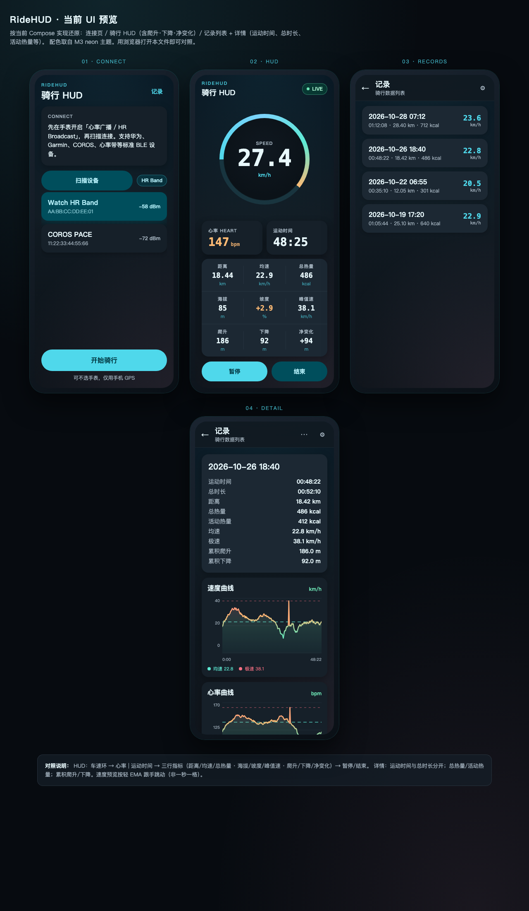

# RideHUD

车把向的 Android 骑行 HUD：大字号车速环 + BLE 心率 + GPS 轨迹指标，前台服务持续采集，Neon MD3 深色界面。

当前版本：**1.0.2**（`minSdk 24` / `targetSdk 36`）

---

## UI 预览

静态截图（与仓库内 HTML 预览一致）：



### 交互预览

本地打开（推荐，数据会动）：

```bash
open preview/ridehud-ui.html
```

或直接点开仓库文件：[`preview/ridehud-ui.html`](preview/ridehud-ui.html)

推送到 GitHub 后，也可用在线预览（无需克隆）：

- [htmlpreview · ridehud-ui.html](https://htmlpreview.github.io/?https://github.com/zhangjie45/RideHUD/blob/main/preview/ridehud-ui.html)

预览覆盖四屏：**连接 / HUD / 记录 / 详情**（速度环、爬升·下降·净变化、运动时间与总热量等与当前 App 对齐）。

---

## 功能

| 能力 | 说明 |
|------|------|
| **HUD 实时仪表** | 车速环、心率、运动时间；距离 / 均速 / 总热量；海拔 / 坡度 / 峰值速；爬升 / 下降 / 净变化 |
| **BLE 心率** | 标准 Heart Rate 广播；华为 / Garmin / COROS / 心率带等；可不选手表，仅 GPS 开骑 |
| **GPS 轨迹** | 前台定位；速度清洗（Doppler + Δd/Δt）+ 轻 EMA；距离与自动暂停/继续 |
| **海拔与坡度** | 气压计优先，GPS 海拔兜底；累积爬升 / 下降 |
| **热量** | 按速度 / 坡度 / 心率估算总热量与活动热量；可填体重；详情可写入手表卡路里做对照 |
| **骑行记录** | 历史列表、详情指标、速度 / 心率 / 海拔曲线；CSV / JSON 导出 |

---

## 技术栈

- Kotlin · Jetpack Compose · Material 3
- Foreground Service（`location | connectedDevice`）
- BLE（`BluetoothLeScanner` + HR GATT）
- `LocationManager` GPS + 可选气压计海拔
- 本地持久化骑行记录

```
app/src/main/java/zj/cursor/ridehud/
├── data/          # BLE / GPS / 海拔 / 录制
├── domain/        # 指标、自动暂停、热量、会话
├── service/       # RideForegroundService
└── ui/            # Connect · HUD · History
```

---

## 构建与运行

1. 用 Android Studio（推荐）打开本仓库，或：

```bash
./gradlew :app:assembleDebug
```

2. 真机调试建议：开启定位、蓝牙、通知权限；手表先打开「心率广播 / HR Broadcast」。

3. Release 需自备签名配置（仓库不包含 keystore）。

---

## 权限

- 精确定位 / 粗略定位  
- 蓝牙扫描与连接（Android 12+：`BLUETOOTH_SCAN` / `BLUETOOTH_CONNECT`）  
- 前台服务（定位 + 已连接设备）  
- 通知（前台骑行通知）

---

## 文档

- [`docs/rea-watch-metrics-brief.md`](docs/rea-watch-metrics-brief.md) — 手表侧指标对照简报  
- [`docs/rea-metric-evidence.md`](docs/rea-metric-evidence.md) — 指标算法证据摘录  

---

## License

个人项目，暂未指定开源许可证。欢迎提 Issue / PR。
